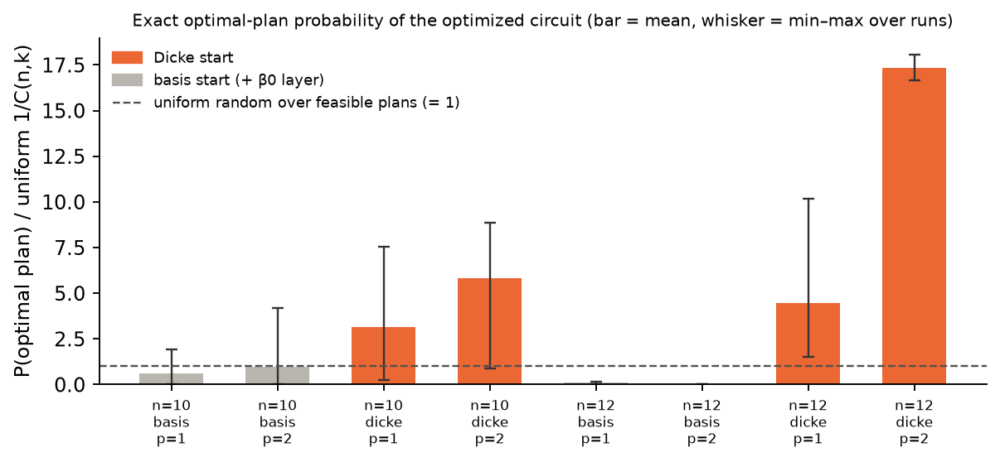

# FloodCut

**Choosing exactly k of n sites with fixed-Hamming-weight QAOA in Qiskit, on a synthetic multi-objective scenario.**

Qiskit Fall Fest 2026 · Disaster Response track · Abdul Hannan (lead), Dayyan Abdullah, Muhammad Dawood Ali Khan



## How it works

Pick `k` of `n` candidate diversion sites (3 of 10, or 3 of 12) while trading off three objectives: a diversion proxy R (maximise), a synthetic harm index H and a district-fairness penalty F (minimise). `E = w_H·Hn + w_F·Fn − w_R·Rn` is an exact QUBO, mapped to an Ising Hamiltonian.

- **Fixed-k QAOA.** One qubit per site, an exact Dicke-state start, an RZ/RZZ cost layer, and a ring XY mixer (RXX·RYY) that conserves Hamming weight, so every sample is a valid k-subset.
- **Honest baselines.** Exact enumeration, greedy and swap-move simulated annealing run on the same `Problem` object, plus the exact 3-objective Pareto set.
- **Safety threshold checked after solving.** `R(x) ≥ τ` is a label, not a constraint: a penalty on a quadratic inequality would be quartic, which is no longer a QUBO.

## Results (ideal statevector simulation)

| setting | P(opt) vs uniform | most-frequent sample optimal |
|---|---|---|
| n=12, Dicke start, p=2 | **17.3×** | 100% |
| n=10, Dicke start, p=2 | 5.8× (0.9–8.9×) | 22% |
| n=10, basis start + β0, p=1 | 0.6× | 0% (collapses) |

- 100% of samples feasible; leakage out of the k-subspace < 1e−30.
- The originally specified basis-state start collapses onto single relabelled states, so the default became a Dicke start.
- Exact enumeration takes under 1 ms at this size. **No quantum speedup or advantage is claimed.**

## Run

```bash
pip install -r requirements.txt && pip install -e .
pytest                                  # 83 checks, incl. an end-to-end quantum smoke test
python -m floodcut quick                # all four methods, live
streamlit run app/streamlit_app.py      # interactive demo
```

Commands, benchmark presets, conventions (bit order, angles, mixer) and limitations: [docs/DEVELOPMENT.md](docs/DEVELOPMENT.md) · Full report: [docs/FloodCut_Report.docx](docs/FloodCut_Report.docx)

---

Python · Qiskit · NumPy · Streamlit · pytest

> **Synthetic, educational prototype.** The river, city, villages, districts and all coefficients are fictional, in normalised units. There are no real locations, no breach coordinates, no methods for altering infrastructure and no hydrological model. Scores are proxies, not lives, depths or damages, and nothing here validates real-world safety.
